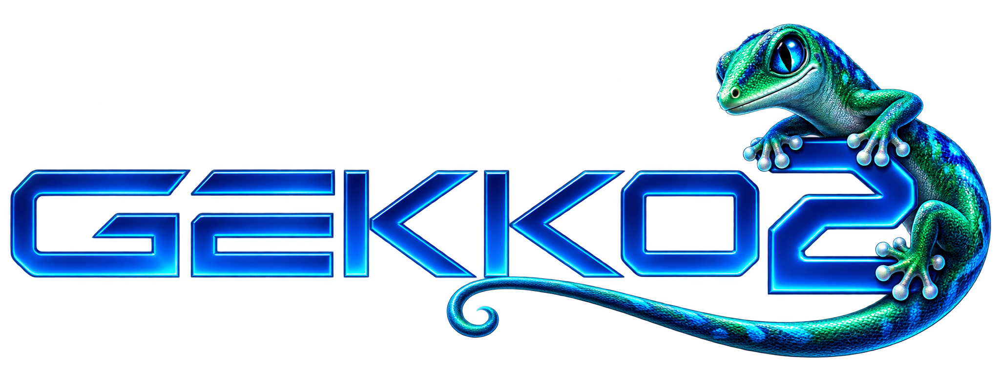
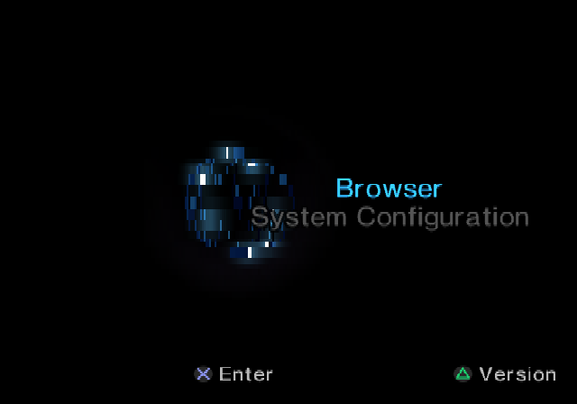
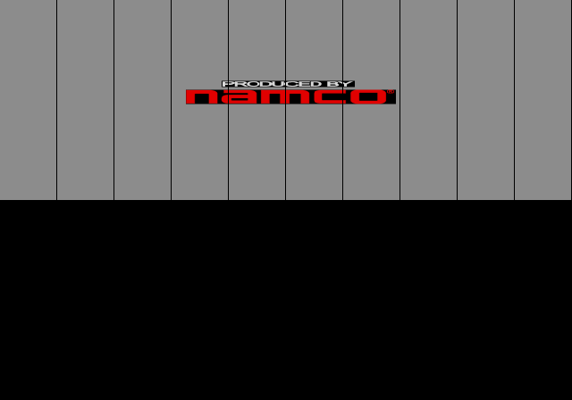
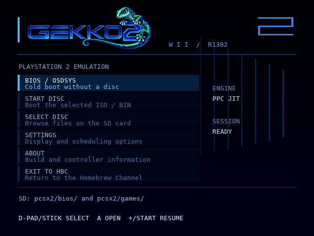

# Gekko2 — SPEED BETA12.27

**Alpha-Vorbereitung (17.10.2026):** [priorisierter Arbeitsplan](docs/ALPHA-ARBEITSPLAN.md),
[Audit aller Menüoptionen](docs/ALPHA-MENUE-AUDIT.md) und
[PCSX2-/Play!-Abgleich](docs/ALPHA-REFERENZABGLEICH.md).
Die geplanten Module und Menüänderungen sind noch offen; keine neue Wii-
Spielbarkeits- oder Geschwindigkeitsbehauptung. Ältere Checkpoints unten sind historisch.

**BETA12.24a:** Automatische 4:3-Verkleinerung zurückgenommen. Die Nutzerkorrektur bezieht sich auf die Fragezeichen-Kacheln in Tekkens Charakterauswahl, nicht auf die gesamte Ausgabe. Wieder volle Ausgabegröße; BETA12.24-Diagnosen bleiben aktiv. Die Kacheln selbst sind noch nicht als korrigiert bestätigt. [Hinweis](docs/BETA12.24a-FULLSCREEN.md).

**BETA12.24 – Spiele-Diagnose:** begrenzte GIF/XGKICK/SIGNAL-/VIF-/Interrupt-Ereignishistorie, getrennte GS-/INTC-Quittierungen, erste unbekannte VU-Paare und EE-Warteschleifen-Kontext. [Anleitung und Testbericht](docs/BETA12.24-GAME-DIAGNOSTICS.md). Keine neue Gameplay- oder Stall-Fixbehauptung; BETA12.23 bleibt Rückfallversion.

**BETA12.23 – Crash/Tekken-Logbatch:** VU-Integer-Lanemasken, VIF-Wartebedingungen und GS-UV-Nachkommabits korrigiert. Standard-4:3-Ausgabe auf einer als 16:9 konfigurierten Wii wird mit Seitenbalken dargestellt. [Analyse, Referenzabgleich und Testbericht](docs/BETA12.23-GAME-LOG-REVIEW.md). Crash zeigt im BETA12.22-Log einen dauerhaften SIGNAL-/XGKICK-Stall; dessen vollständige Ursache und Gameplayfortschritt bleiben auf neuer Wii-Hardwareausführung zu prüfen. Kein belegter Gesamt-FPS-Gewinn.

**BETA12.22 – GS/GX-Formate und Fehlerbehandlung:** alle 13 gültigen GS-Texturformate werden für GX nach RGBA8 dekodiert. CT32/24/16/16S sind für GX-Scanout verfügbar; CT16/16S verwenden bei geeigneten Zeichenoperationen einen GX-Snapshot mit präzisem GS-Readback. Dazu kommen Korrekturen für CSM2-Paletten, AFAIL-Alpha, XGKICK und IPU sowie eine Pause bei terminalem GX-Fehler. [Build- und Testbericht](docs/BETA12.22-GS-GX-FORMATS.md). Chain-Residenz und experimentelle lokale PSM-Konvertierung bleiben standardmäßig OFF. Crash-Schwarzbild, lila Ausgabe und BIOS-Kacheln sind auf echter Wii weiterhin nicht als behoben bestätigt.

**Experimenteller Stand BETA12.21:** opt-in Native-to-Native-128-Bit-Ketten für geprüfte ALU/MMI-, LQ/SQ-/LD/SD- und Integer-Sprungblöcke; eigener gespeicherter Cold-Boot-Schalter, standardmäßig OFF. PSM ebenfalls OFF. Sichere GX-Abschluss-/Fehlerprüfung und CT32/24-DTHE-Zugang. [Bericht](docs/BETA12.21-EXPERIMENTAL-OPTIONS.md). Host-/PPC-Tests und Wii-Cross-Build ersetzen keinen realen Wii-Test; Crash-Schwarzbild und BIOS-Kacheln bleiben ohne Hardwarebestätigung. Die folgenden älteren Abschnitte sind historisch.

## Historical note: BETA12.10 – GS Local-to-Local safety

BETA12.9 implemented `TRXDIR=2`; BETA12.10 checks GPU readback success
and handles same-surface overlapping GS moves safely even if DIRX/DIRY are
unsuitable. Supported format pairs remain same-PSM only. See
`tests/test_gs_local_move_beta12_10.c` and `docs/BETA12.10-TRXDIR2.md`.
No physical Wii compatibility/gameplay claim.

# Gekko2 — PS2 emulator for Nintendo Wii

**Current source checkpoint: R1389-SPEED-BETA12.27-GX-RISK-OPTION (16 October 2026).**
Experimental Wii development build. No claim of playable game compatibility.

## BETA12.9 – targeted GS correctness and safe VBlank speed extension

- Real GS `TRXDIR=2` local-to-local VRAM copying for equal supported pixel
  formats, including directional overlapping transfers. Previously silently
  ignored. Unsupported format conversions are declined, not guessed.
- Correctly decode `BITBLTBUF` source buffer, `TRXPOS` source coordinates,
  DIRX/DIRY transfer ordering; preserve destination alpha in PSMCT24.
- Diagnose `GS_LOCAL_COPY transfers/declines/pixels` in hardware logs.
- Recognize a second, *verifiable* EE VBlank polling form with a hoisted
  base pointer (`LW/ANDI4/BEQZ/NOP`) when its live GPR addresses precisely
  `EE_INTC_STAT` and the real interrupt is not pending. Event deadlines and
  all prior DMA/SIF/VU guards remain active.
- **Neither Crash E3 in-game nor faster BIOS, Tekken, or GT3 is yet
  confirmed on a physical Wii with this build.** BETA12.7 reached >2
  emulated VBlanks/s briefly but the selected front buffer remained black.
- Test and research notes: `docs/BETA12.9-GS-TRANSFER-RESEARCH.md`.

This source builds upon R1389 → BETA12.1 → BETA12.2, preserving the guarded
1–2 MiB EE JIT admission and diagnostic sampling. BETA12.3 adds a provider-
verified legacy FILEIO RPC `0xff` version reply, guards both known FILEIO
OPEN path layouts, and matches CD paths case-insensitively as ISO9660 names.
The private Crash Bandicoot E3 disc's real font file opens in the targeted
host RPC test, but **Wii/Dolphin title rendering and in-game 3D are unverified**.

BETA12.4 is a diagnostic-only step after a real Wii Software/GX comparison:
Crash E3 reaches the game's own `NuError` fatal-loop at EE `0x00103D70`.
The new read-only, fingerprint-gated `CRASH_E3_NUERROR` log record captures the
previously invisible formatted guest error, caller PC and selected FILEIO version.
**This is not a gameplay fix.** The full 45-minute log is not needed again:
if the same stop recurs, the record should appear shortly after it is reached.

BETA12.5 Wii trace confirmed all six FILEIO opens failed with malformed
`????cdrom0:` paths. BETA12.6 recognizes the captured legacy 2110 request's
pathname at offset 8 (alongside valid offsets 0/4/12), enabling genuine ISO9660
lookup without bypassing the game's error handler. Later physical Wii tests
confirmed `FIRST_IMAGE=1` and the font loaded; entering gameplay is still
not confirmed. See `open_offset`, `GS_BUFFER_COMPARE` and `GS_LOCAL_COPY`.

- [BETA12.6 FILEIO packet fix and verification](docs/BETA12.6-CRASH-FILEIO-OPEN-OFFSET.md)
- [BETA12.4 NuError evidence and verification](docs/BETA12.4-CRASH-E3-NUERROR.md)
- [BETA12.3 FILEIO implementation and verification](docs/BETA12.3-CRASH-E3-FILEIO.md)
- [BETA12.2 EE low-memory JIT and GT3 log findings](docs/BETA12.2-CRASH-GT3-LOG-ANALYSIS.md)
- Build BETA12.6: `bash tools/build_beta12_6_fileio_open.sh` with configured devkitPPC/libogc (the test build uses a reduced Lightning optimization level; not an FPS baseline).
- Never commit BIOS dumps, disc images, personal RAM/checkpoints or SDK binaries.
- Project website: https://mafiacoding.github.io/Gekko2/

---

## Previous implementation notes and credits

> **Historischer Stand: R1389 GX-Hardware-Test.** Siehe [Prüfbericht](docs/R1389-GX-Alpha.md) und [Claude-Handoff](docs/R1389-Claude-Handoff.txt). Build: `GEKKO2_NATIVE_GPU_TEST=1 bash tools/build_r1389.sh` mit moderner devkitPro-Umgebung; private AOT-Profile optional als Argument. Wii-Pixel/FPS und BIOS-Kacheln sind noch nicht bestätigt.

## R1387: independent GIF / GS Q

Preserves R1386 AOT and modern DSI toolchain. Corrects Q latching and
checkpoint compatibility. The reported BIOS/PCSX2 visual discrepancy
remains unresolved: ten controlled BIOS captures are unchanged.
See [implementation, tests and exact limits](docs/R1387-GS-Q.md).

## R1386: guarded AOT windows and IRQ/checkpoint fixes

Modern DSI build with devkitPPC r50 / GCC 16.1.0 / libogc 3.1.0.
Preserves R1384 accuracy and R1385 timed VU hybrid JIT. Adds cached AOT
lookup, guarded arithmetic windows, idle graphics service checks, safe
IRQ wakeup/preemption, VU1 cold reset and negotiated pad checkpoint state.
See [fix inventory and remaining limits](docs/R1386-FIX-ABGLEICH.md).
PPC instruction reductions are measured in a modeled linked binary;
physical Wii speed, BIOS crash and correct Tekken/GT3 gameplay remain open.

## R1385: timed VU hybrid blocks

VU0/VU1 production paths use dynamically emitted PPC blocks with precise
per-pair timing and source guards. Native fused non-arithmetic pairs are
available inside the timed scheduler. See [R1385 details](docs/R1385-TIMED-HYBRID-JIT.md)
for executable validation and remaining accuracy/gameplay limits.

# R1384 Codex checkpoint

R1384 adds executable FMAC timing, VU0 M continuation, resumable GIF/VIF DMA,
a CPU GIF FIFO, and general word residency across all 128 EE GPR words.
The DSI build uses the recovered devkitPPC r50 / libogc 3.1.0 Docker SDK and
the owner's AOT profile. See [R1384 implementation and limits](docs/R1384-CODEX-HARDWARE.md).
Complete hardware accuracy and a fully native timed VU backend remain unproven;
physical Wii boot/game/FPS checks are pending. Earlier sections below are
historical checkpoint evidence.

# R1379-AOT3 — AOT2 continuation and PCSX2/GIF fixes

The working AOT2 workflow is retained with guarded EE delay slots, BC2,
LQC2 VF0 reads, correct J/JAL regions and metered VU1 XGKICK transfers.
The R1379B incomplete-PATH1 fix is included. Existing graphics/VIF/CHD
corrections remain present. The owner reports approximately halved BIOS
boot time and nearly 0.30 FPS in Tekken for AOT2; AOT3 hardware performance
has not yet been measured. Full dynarec and PS2 hardware fidelity remain
in development. See [changes, reproduction, evidence and remaining gaps](docs/R1379-AOT3.md).

# R1378-AOT2 — experimental EE/IOP/VU static compilation

The optional hybrid workflow now compiles selected EE, IOP, VU0 and VU1
instructions ahead of time, using shared interpreter semantics and the existing
precise CPU/pipeline boundaries. The source ships empty generated tables;
private input is required to build specialized code. Host regressions, linked
PowerPC comparisons and the Wii MEM1 gate pass. Physical Wii boot and FPS
improvements remain unverified. See [scope, reproduction and limits](docs/R1378-AOT2.md).

# R1342 — EE prefix reuse, CPU guards and IOP deadlines

Four independently selectable optimizations reduce short EE grant overhead,
inactive CPU service calls, repeated THREADMAN scans and historical diagnostic
work. MLOAD status 1 is supported with complete-buffer/readback verification.
See [implementation, source audit, measurements and limits](docs/R1342-PERFORMANCE-CPU-ARM.md).
Warm short-grant tests improve by 21%; a mixed EE/IOP replay improves by 0.7%.
These synthetic PPC instruction counts do not establish doubled Wii FPS.
The four CPU options default ON and require cold boot. A separate default-OFF
experimental ARM option delegates large IOP BIOS RAM jobs to MLOAD and verifies
every byte. ARM/IOS changes require an app restart. Physical R1342 boot, ARM
handshake and a RAM-job speedup remain unverified.

# R1341 — cache/retirement and ARM transport test build

Guarded EE lookup/admission hints, reduced duplicate IRQ/IOP fetch work,
event-safe PPC timer bookkeeping and verified MLOAD status-zero transfers.
Short host button presses persist until the guest controller samples them.
See [implementation, measured tests and limits](docs/R1341-PERFORMANCE-ARM.md).
Targeted synthetic EE replay uses 6.07% fewer PPC instructions; a mixed replay
is essentially unchanged (+0.10%). **A 2x/3x Wii speedup is not established.**
ARM startup still requires a physical Wii test; its worker currently handles
CSC only. R1340 Tekken streaming stays intact. PLUS pauses; MINUS+A sends
PS2 START. No new setting is required.

# R1340 — retail sound/streaming transport

Verified-provider RSPU2 initialization/status, bounded disc-to-EE video reads,
separate 7/128 audio/video group extraction, sound-parameter storage and
checkpoint persistence. A private native cold boot now renders the **Tekken
Tag Tournament title graphic** in the real GS viewport. Interactive title
navigation, a complete FMV and streamed audio playback remain unverified;
physical Wii performance/compatibility requires a new test. See
[R1340 implementation and limits](docs/R1340-TEKKEN-STREAMING.md).

R1339 ARM loader bounds/diagnostics and R1338 cache/IOS settings are retained.
The owner's R1338 log measured FIRST_IMAGE 509303 ms vs 552449 ms; ARM completed
zero jobs. Those measurements do not establish a new R1340 speedup.

## Historical checkpoints

R1338: EE recency / budget admission, persistent ARM settings and explicit
CURRENT / IOS222 startup selection. See [R1338 details](docs/R1338-CACHE-ARM-IOS.md)
and packaged verification results; physical Wii speed/ARM loading unverified.

# R1337 development checkpoint

BDEC/IDEC coefficient reconstruction and IDCT, size-class executable arena,
and experimental MLOAD ARM worker loading. See [R1337 evidence and limits](docs/R1337-DECODER-CACHE-ARM.md).

<p align="center"></p>

# Gekko2 for Nintendo Wii

## Historical R1335 IPU / HLE / cache comparison checkpoint

Real IPU FIFO data, FDEC/tables/CSC, resumable TO/FROM DMA and checkpoint state.
Known HLE RAM copy/fill calls gain a bounded bulk path; unknown-call fallback
is independently testable. Compact EE cache enables a 1024/4096-owner A/B.
Optional asynchronous ARM CSC client and portable worker handler are prepared;
no IOS server is installed and no ARM speedup is claimed. MPEG decode is open.
See [R1335 handoff](docs/R1335-IPU-HLE-ARM.md) for defaults, verification and limits.

## R1334 cache and game-diagnostic checkpoint

Block cache reuse ON now retains 4096 EE block owners; OFF retains 256.
The executable arena stays 6 MiB. Missing boot-local IOP masks/counters reset.
IPU_STATUS/IPU_COMMANDS expose the existing decoder gap during game tests;
MPEG output remains unimplemented. ARM offload is future work.
Validation: 26 linked PPC suites, focused CPU/IOP/IPU/log checks, and both Wii cross-builds pass.
See [R1334 handoff](docs/R1334-EE-CACHE-GAME-DIAGNOSTICS.md) and
[ARM measurement plan](docs/R1334-ARM-ROADMAP.md). Synthetic cache replay
improvements are not measured Wii FPS gains.

## R1333 cold boot / budget-cache checkpoint

The launcher now has **COLD BOOT / NEW LOG**. Each fresh boot reserves a
separate numbered file under `sd:/pcsx2/logs/`; previous runs are preserved.
START/PLUS pauses and resumes an existing session. CPU optimization settings
and the master GX setting apply on a cold boot. Guest PS2 START is MINUS+A
on Wii Remote, or Z+A on GameCube; MINUS+PLUS / Z+START toggles the HUD.

With **Block cache reuse** enabled, EE cache lookup keeps different block
lengths for the same PC and selects the largest one fitting the current
execution budget. A synthetic alternating-budget replay reduces executed
PPC instructions about 18%; this is not a measured Wii FPS gain.
Both DOL/ELF builds pass structural checks; 25 linked PPC suites and 64 native
GS tests pass, plus repeated cold-boot and log error tests. Physical Wii
verification of R1333 and a BIOS boot fix are not established.

See [R1333 controls, logging and verification](docs/R1333-COLD-BOOT-CACHE.md).

### Earlier R1332 cache profiler / IOP RAM checkpoint

R1332 adds the independently selectable **Block cache reuse** option,
four-way EE/IOP block caches, budget-aware IOP compilation and exclusive
sampled CPU profiling. Fastmem also selects guarded direct PPC IOP RAM
loads/stores; IOP COP0 transfers now use native PPC bodies. Device services,
exceptions, unsupported instructions and exact guest boundaries remain.

The Optimized and Control builds default cache reuse ON/OFF respectively;
both include the same renderer, profiler and 6 MiB arena. Saved options
override defaults. Fastmem remains experimental and default OFF.

See [R1332 controls, counters and verification limits](docs/R1332-CACHE-PROFILER.md).
The package contains both DOL/ELF pairs and the complete source checkpoint.
No physical Wii boot, playable gameplay or FPS improvement is claimed.

### Earlier R1331 CPU / GX options checkpoint

The launcher exposes thirteen independent CPU/GX options under
**Settings → Down → CPU / GX Optimizations**. Options are saved on SD and applied
at the next cold boot; resuming keeps the current execution mode.

R1331 adds a shared 6 MiB code arena with stable PPC addresses, safe independent
VRAM writes, and an experimental RAM-TLB page cache (default **OFF**). Precise
guest boundaries and exact-state graphics fallbacks remain. Options and
Reference use the same renderer; Reference omits the arena and starts with EE
blocks disabled. Saved settings override defaults where available.

See [the six optimization batches](docs/R1331-BATCHES.md), including **Fastmem as
batch 6**, for status, controls, validation and remaining work. Persistent FPU
pinning, directly patched block branches, general Gouraud depth/alpha coverage,
and PPC-MMU/DSI Fastmem are still open. No Wii FPS gain or physical boot
verification is claimed for this checkpoint.

Earlier checkpoint descriptions below are historical.


**Experimental PlayStation 2 emulation • Early alpha • Alpha coming soon**

Gekko2 explores PS2 emulation on Nintendo Wii hardware. Alex has spent approximately eight months reading, debugging and testing the project, with assistance from Claude AI and later ChatGPT/GPT-6.1. The original goal was to get the real PS2 BIOS running before attempting games or playable performance.

That work now produces the Sony Computer Entertainment startup screen on a real Wii. The OSDSYS menu renders in the native development build, where entering the Browser and returning to the menu has been tested. Stable, responsive OSDSYS navigation on Wii remains a development goal.

**Historical R1308 core baseline.** This builds on R1307's precise EE/IOP blocks and audited scalar register residency. VU Q/P issue timing, WAITQ/WAITP, all 13 scalar EFU operations, lower flag queries, dual-issue VF hazards, I-literal ordering and wrapped PATH1 packets are implemented. Event-free EE peripheral timer intervals are deferred with precise IRQ boundaries and materialized MMIO/snapshots. Read [STATUS.md](STATUS.md), [the R1308 handoff](docs/R1308-HANDOFF.md) and [the completion plan](docs/DYNAREC-COMPLETION-PLAN.md). Full FMAC flag/hazard timing, asynchronous VIF/GIF scheduling, general event batching and physical-Wii performance remain unfinished.

## Why Gekko2?

Previously called PCSX2-Wii, the project now has its own name to reflect its Wii-specific frontend, custom PowerPC recompiler and experimental GX renderer. The gecko mascot nods to Nintendo's PowerPC heritage; the “2” refers to PlayStation 2. Existing `sd:/pcsx2/` data paths remain compatible with older installations.

PCSX2 remains an important source and semantic reference. Gekko2 is an independent homebrew project, not an official PCSX2 release.

## Progress gallery

<p align="center"></p>

*OSDSYS: native development framebuffer capture, not a Wii hardware screenshot.*

<details>
<summary>Tekken Tag Tournament boot progress</summary>



*Historical R1258 native development capture of the Namco startup logo. Subsequent R1297 work fixes the observed retail resource-transfer fault and fractional sprite seams. This image demonstrates boot progress, not a working title screen or gameplay. The owner has also reported reaching the Namco logo on Wii; no playable performance is established.*

</details>

<details>
<summary>Gekko2 launcher preview</summary>



*R1302 host render of the actual launcher drawing routines, not a Wii photograph.*

</details>

## Current features

- R5900 EE and IOP interpretation, guest memory, interrupts, timers, DMA and SIF services.
- Experimental native PPC translation, conservative EE blocks and guarded VU instruction pairs/blocks. EE/IOP/VU coverage and timing remain incomplete.
- Software GS rendering plus one optional **GX (EXPERIMENTAL)** setting for presentation and supported hardware draw paths. Complex states still use software or hybrid handling.
- A Wii launcher with an SD ISO/BIN browser, optional diagnostics and a switchable FPS counter.
- Wii Remote, optional Nunchuk and GameCube controller support; launcher/HBC exit actions.
- SD diagnostics for BIOS startup, JIT counters and GX routing/synchronization.

## Install on SD

Use a build produced from this source. Place the chosen DOL, `meta.xml` and `assets/branding/icon.png` together:

```text
sd:/apps/gekko2/boot.dol
sd:/apps/gekko2/meta.xml
sd:/apps/gekko2/icon.png
```

Place your own BIOS dump in `sd:/pcsx2/bios/`. The loader checks `SCPH50004.bin`, `SCPH39001.bin`, `SCPH10000.bin`, then `bios.bin`. Most verification uses SCPH-50004; other BIOS revisions are not equally verified. Choose **BIOS / OSDSYS** for a disc-free boot.

Optional disc images can go in `sd:/pcsx2/games/`, or be selected elsewhere on SD using the ISO/BIN browser. CHD is not currently supported by the launcher. Disc changes apply on a new boot; resume retains the mounted image.

Configuration may be written to `sd:/pcsx2/bios-config.bin`. R1334 boot logs have numbered names such as `sd:/pcsx2/logs/Gekko2-R1334-0000000001-bios-gx.log`. CPU optimization options persist on SD and apply at a cold boot; resume retains active options. Startup diagnostics remain in `sd:/pcsx2/Gekko2-startup.log`. Please identify the build, controller, software/GX setting and BIOS revision when reporting an issue; never attach BIOS, disc images or guest RAM/checkpoints.

## Controls

| Action | Wii Remote / Nunchuk |
| --- | --- |
| Navigate launcher | D-pad / Nunchuk stick |
| Confirm / back | A / B |
| Pause / resume existing session | PLUS (HOME also pauses) |
| Cold boot / new log | Select COLD BOOT / NEW LOG, then A |
| Toggle HUD during emulation | MINUS + PLUS |
| Exit to Homebrew Channel | HOME + MINUS, or EXIT TO HBC |
| Toggle FPS in SETTINGS | 2 |
| Toggle diagnostic HUD in SETTINGS | A |
| Toggle update budget in SETTINGS | 1 |
| Toggle GX in SETTINGS | LEFT / RIGHT |
| PS2 Cross / Circle | A / B |
| PS2 Square / Triangle | 1 / 2 |
| PS2 Start / Select | MINUS + A / MINUS |
| PS2 L1 / R1 | Nunchuk C / Z |

Nunchuk movement currently maps to digital directions, not a complete analog-pad protocol. GameCube controllers are supported; B + Z + START requests HBC exit.

## Build

Install devkitPPC and libogc, then set their paths:

```sh
export DEVKITPRO=/path/to/devkitpro
export DEVKITPPC="$DEVKITPRO/devkitPPC"
export PATH="$DEVKITPPC/bin:$PATH"
sh tools/build_r1306.sh
```

This produces `Gekko2-R1306-Menu-JIT.{elf,dol}` and `Gekko2-R1306-Menu-Interpreter.{elf,dol}`. The validated toolchain is devkitPPC r32 / libogc 1.8.18 with libfat, wiiuse and bte. Other toolchain versions have not been verified for identical behavior. The Makefile supplies an ELF-to-DOL fallback; SDK/compiler distributions are not included.

## Verification

```sh
python3 tools/verify_regressions.py
```

The native suite requires GCC and Python. PPC verification additionally requires Python `unicorn` and, for linked-ELF tools, the built ELF and `powerpc-eabi-nm`:

```sh
python3 tools/verify_ee_extensions_r1306.py Gekko2-R1306-Menu-JIT.elf --nm "$DEVKITPPC/bin/powerpc-eabi-nm"
python3 tools/verify_gs_paths_r1285.py Gekko2-R1306-Menu-JIT.elf --nm "$DEVKITPPC/bin/powerpc-eabi-nm"
```

Host tests cannot execute native PPC directly. Synthetic PPC instruction counts are not Wii cycles or BIOS/game FPS. [STATUS.md](STATUS.md) distinguishes current native/PPC tests, historical artwork checks and owner hardware observations.

## Credits and license

Thank you to the **PCSX2 team and contributors** for their PS2 emulator, code, documentation and research. EE instruction semantics originated from PCSX2 references/ports; attribution and GPL notices remain in the source. The name change does not remove those origins.

- [PCSX2](https://pcsx2.net/) / [source](https://github.com/PCSX2/pcsx2)
- [ps2sdk](https://github.com/ps2dev/ps2sdk): PS2 interfaces and reference documentation.
- [devkitPro](https://devkitpro.org/) and [libogc](https://github.com/devkitPro/libogc): Wii toolchain and platform libraries.
- Bundled ELF-to-DOL/wiiload tools retain their individual licenses. Font attribution is in [docs/licenses/DejaVu.txt](docs/licenses/DejaVu.txt).
- Alex: project development, hardware testing and direction, with Claude AI and ChatGPT/GPT-6.1 assistance.
- Gekko2 logo artwork was created with image-generation assistance; see [branding notes](docs/BRANDING-R1302.md).

The project is **GPL-3.0**; see [COPYING.GPLv3](COPYING.GPLv3). Third-party files retain their own notices and terms. Gekko2 is independent of the credited teams.

BIOS ROMs, game images, private guest RAM/checkpoints, personal runtime logs, BIOS configuration and SDK/compiler binaries are excluded from the public source tree.

## BETA12.5 FILEIO TRACE
The BETA12.4 **real Wii log** confirmed the guest's genuine stop:
`NuError - nufont.c(117) : unable to create font fonts\ariel32`
with selected legacy FILEIO provider 2110 and no ISO transport failures.
BETA12.5 is **read-only transport tracing**: it adds `FILEIO_TRACE` on changed
RPC counts and `CRASH_E3_FILEIO` at the NuError stop. No game behavior is fixed.
See [BETA12.5 analysis](docs/BETA12.5-CRASH-FILEIO-TRACE.md).
For a Wii build, `tools/build_beta12_5_fileio_trace.sh` needs devkitPPC/libogc.


### BETA12.13 GS alias / framebuffer synchronization
See `docs/BETA12.13-GS-ALIAS.md` for physical PS2 GS eDRAM page views, GX coherency and bounded overlapping format copies. On real Wii use `GS_ALIAS_SYNC` and `GS_BUFFER_COMPARE` log lines. No Wii in-game guarantee.

### BETA12.15: Dynarec + scheduler + GX hot paths
This diagnostic release reduces EE cache-lookup overhead, specializes
single-tick IOP grants, and avoids redundant GX texture invalidations on
verified cache hits. See `docs/BETA12.15-JIT-SCHED-GX.md` for tests and
remaining emulation gaps. Neither full PS2 accuracy nor a Wii FPS gain is
claimed without device-side measurements.


## BETA12.19 addendum (2026-10-15)
See `docs/BETA12.19-FB16-JIT-GUARD.md`: CT16/CT16S native framebuffer writes, FBA/FBMSK/DATE, depth saturation and EE JIT fault fences. Wii gameplay and independent-block 128-bit PPC pinning remain unverified/open.


## BETA12.20 – GS TEST/DATE/AFAIL CPU-GX-Sprite-Import

Neue CPU-GX-Sprite-Verarbeitung für DATE, ATE/AFAIL, Alpha-Erhalt, FBA/FBMSK und spätes Z-Schreiben. 159 neue Testchecks + 324 GX-Pipelinefälle + 16 FB16-Checks bestanden. Wii-Cross-Build bestandene DOL-/ELF-/MEM1-Prüfung. **Keine** persistente 128-Bit-PPC-Registerübergabe über unabhängige JIT-Blöcke; siehe `docs/BETA12.20-GX-ALPHA-RESIDENCY-PLAN.md`. Crash E3 weiterhin unbestätigt.
