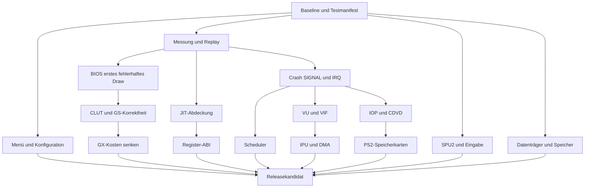

# Gekko2: Arbeitsplan bis zur öffentlichen Wii-Alpha

**Umsetzungsstand BETA12.28:** [Batches und Nachweise](ALPHA-UMSETZUNG.md),
[Build-/Restumfang](BETA12.28-ALPHA-CORE.md). A01-Menü/Dateiverträge,
A04-CLUT-Neuinterpretation, A05-Zweikreis-Scanout, A12-CPU-FIFO-Retries und
A14-Karte/Standard-FAT/MCSERV sind umgesetzt; das schließt die übrigen
Teilziele dieser Pakete und ihre Hardware-Gates nicht automatisch ab.
A02/A03/A07 benötigen weiterhin den identischen fehlerhaften Spiel-/BIOSzustand;
A06/A08–A13/A15–A17 enthalten weitere Accuracy-/Performance-/Releasearbeit.
Die folgende Audit-Basis und ihre geplante Liste bleiben als Verlauf erhalten.

Stand: 17.10.2026. Geprüfte Codebasis: `c51ab567f651195beb0470b11419d8b7eafa4fd8`
(`R1389-SPEED-BETA12.27-GX-RISK-OPTION`). Arbeitsbranch:
`codex/alpha-readiness-audit`. GitHub-main wurde erneut als `ca16340e`/
BETA12.20 geprüft. Die folgenden Implementierungen sind **geplant**;
der Audit selbst ändert keine Emulator-Semantik und erzeugt keine neue DOL-Version.

## Ergebnis der Bestandsaufnahme

Eine öffentliche Alpha braucht eine belastbare Standardkonfiguration,
reproduzierbare Fehlerberichte und eine ehrliche Kompatibilitätsliste.
Alle PS2-Spiele und alle Hardwaremodule fertigzustellen ist kein begrenztes
Alpha-Kriterium. Wir definieren einen überprüfbaren ersten Spielumfang und
erweitern die gemeinsamen Hardwarepfade anschließend weiter.

| Bereich | Tatsächlicher Stand | Konsequenz |
|---|---|---|
| Menü | 32 Kernschalter, drei getrennte Experimente und vier Frontend-Einstellungen; alle Kernschalter haben Aufrufstellen | Oberfläche vereinfachen, Backend-/Rollback-Optionen erhalten; [vollständiger Menüaudit](ALPHA-MENUE-AUDIT.md) |
| Einstellungswirkung | Im BETA12.27-Testprofil bleibt nach explizitem All-OFF `active=00001080`: GX resident und Gouraud werden beim Apply erzwungen | Vor Alpha Auswahl/aktive Werte vereinheitlichen; Renderer global separat prüfen |
| JIT | EE/IOP/VU-PPC-Pfade, lokale Lane-Residenz und opt-in geprüfte Native-Ketten vorhanden | Kein vollständiger Native-JIT; Dirty-Writeback, breitere Kettenabdeckung und Hardware-Nachweise offen |
| GS/GX | 13 Texturquellformate, Hybridpfade, CT16/16S/24/32-Scanout und gemeinsame Shader vorhanden | Dekodierung eines Formats bedeutet keine vollständige native GX-Unterstützung aller Ziel-/Blendzustände |
| BIOS | SCPH-50004-Kacheln laut Nutzer weiterhin beschädigt | P0-Bildfehler; aktueller gleicher Gastzustand und erstes abweichendes Draw erforderlich |
| Crash E3 | Historischer SIGNAL/PATH1/XGKICK-Stau nachgewiesen; aktueller Fix nicht bestätigt | IRQ-/Quittierungs-/Producerfolge untersuchen; keine künstliche Entstörung |
| Tekken | Charakterauswahl sichtbar, Kacheln und Übergang in den Kampf unbestätigt | Gemeinsame GS/VU/GIF-Pfade reparieren; keine erneute automatische Bildverkleinerung |
| Scheduler | Eventpfade existieren; globale EE:IOP-Relation basiert weiter auf Instruktionsslots | Eventoptimierung und echte Zyklentreue sind verschiedene Arbeiten |
| IPU | IDEC/BDEC/VDEC/FDEC/CSC/PACK, VLC/IDCT, Retry/DMA existieren | Nicht als fehlendes Gesamtmodul neu schreiben; Stream-/Timing-/Fehlerfälle schließen |
| Speicherkarten | SIO2 implementiert PS1-Karten; MCSERV teilweise cardless/Legacy-HLE | Native PS2-Karte, persistenter Speicher und korrekte RPC-Fehler sind echte Lücken |
| SPU2 | ADPCM/ADSR/Pitch/IRQ und Ausgabe vorhanden | Noise/PMON/Sweep/Reverb/Gaussian offen; Sound OFF schaltet aktuell nur die Ausgabe ab |

Quellen und Grenzen des Referenzabgleichs: [PCSX2/Play!-Audit](ALPHA-REFERENZABGLEICH.md).
Alte Kommentare sind keine Abdeckungsliste: Beispielsweise sind MADD und QFSRV
bereits implementiert, obwohl spätere Kommentare sie noch als fehlend nennen.

## Freigabestufen

**Alpha 0 – öffentliche Entwicklerpreview:** reproduzierbares Paket,
SCPH-50004-Kaltstart und OSDSYS-Bedienung auf echter Wii, korrigierte bzw.
präzise eingegrenzte BIOS-Bildfehler mit dokumentiertem Restumfang, funktionierendes
Pause/Resume/Cold Boot/HBC, nachvollziehbare Optionen, keine bekannten
Speicherbeschädigungen und ehrliche Spieleliste. Nicht als spielbare Spiele-Alpha
bewerben, solange kein Spiel den folgenden Nachweis hat.

**Alpha 1 – begrenzter Spielsupport:** mindestens Crash E3 bis in eine steuerbare
Spielszene und Tekken Tag bis in einen steuerbaren 3D-Kampf mit dokumentierter
genauer Disc-Version, Wii-Hardware, Bildfehlern und Geschwindigkeit. Der Test
muss Eingaben, Szenenwechsel und mindestens einen abgeschlossenen Spielabschnitt
einschließen; eine animierte Auswahl zählt nicht als Gameplay. GT3 bleibt separat
gelistet, bis Kartenabfrage und Rennstart tatsächlich funktionieren. KOF erst nach
Identifikation der konkreten Fassung bewerten. Weder diese Gate-Liste noch eine
Versionsnummer belegt, dass die Tests bereits bestanden wurden.

Geschwindigkeit getrennt von Kompatibilität ausweisen. Langsames Gameplay kann
ein Progressionsnachweis sein, aber noch kein praktisch spielbares Ergebnis.
Kein fester FPS-Termin, bevor vergleichbare Wii-Messungen vorliegen.

## Reihenfolge und Abhängigkeiten

Die Grafik zeigt fachliche Abhängigkeiten; experimentelle Vollausbauten sind
keine Voraussetzung für Alpha 0, wenn sie deaktiviert und korrekt dokumentiert
bleiben. Alle Pflichtpfade des gewählten Alpha-1-Spielumfangs sind Voraussetzung
für dessen Freigabe. Jeder PR implementiert einen begrenzten Unterpunkt;
kein Sammel-PR für einen ganzen CPU-/GS-Neubau.

## A00 – reproduzierbare Basis und offene Befunde (P0)

- BETA12.27 gegen main und die gestapelten Batches konsolidieren, ohne bestehende
  AOT/SPEED/DSI/GX-/Idle-Funktionen zu verlieren. Separate Review-Branches;
  main erst nach Review und erfüllten Gates aktualisieren.
- Ein Buildmanifest mit Quell-SHA, SDK-Digest, Compiler-/libogc-Version,
  vollständigen Flags, generierten AOT-Tabellen (leer oder privat), DOL-Hash,
  Optionen und MEM1/MEM2-Verbrauch erzeugen. Keine privaten Profile verteilen.
- README, STATUS und Handoff auf einen klaren aktuellen Kopf bringen;
  widersprüchliche historische Absätze ausdrücklich historisch belassen.
- Aktuelle 55-Suite-Kette als Baseline erhalten; übrige Tests inventarisieren.
  Das Repository enthält 370 Testdateien (363 davon C), nicht 370 aktuell ausgeführte Suites.
  Stale Fixtures/fehlende Linkabhängigkeiten von echten Produktfehlern trennen.
- Gate: unveränderte Quellbasis reproduzierbar bauen; aktuelle Pflichtprüfungen,
  All-OFF-/Default-Konfiguration, Cold Boot und Speicherprüfung dokumentieren.

## A01 – Menü und Konfigurationsvertrag (P0)

Dateien: `include/frontend.h`, `source/main.c`, `optimization.[ch]`,
`experimental_options.[ch]`, `wii_arm_ios.c`.

- [Menüaudit](ALPHA-MENUE-AUDIT.md) umsetzen: normale Einstellungen, Diagnose,
  drei unabhängige Experimente; technische Teiloptionen hinter Profil/Entwicklerseite.
- Stabile IDs 0..31 und v1..v9-Import erhalten; keine Bits verschieben, kein
  `1u<<32`. Für neue normale Optionen benannte Schlüssel/eine versionierte
  Struktur statt Vergrößern der bereits vollen Maske.
- Wunsch, wirksamer Wert, Buildfähigkeit, Runtimefähigkeit und Ablehnungsgrund
  getrennt darstellen. Abhängige Optionen nicht stillschweigend aktivieren.
- Erzwungene GX-Bits des Testbuilds entfernen oder nur in einem ausdrücklich
  benannten GPU-Testprofil halten; globales GX OFF muss weiterhin den
  Softwarepfad wählen. JIT-/DSI-/ARM-Abhängigkeiten prüfen.
- HUD/FPS/Update/GX speichern; transaktionale SD-Datei und Backup behalten.
  Standardwerte wiederherstellen als eigener Menüpunkt mit sichtbarem Ergebnis.
- Alle Einträge mit D-Pad+A erreichbar; X/Y lediglich als zusätzliche Abkürzungen.
  Cold Boot und App-Neustart eindeutig unterscheiden; Resume wendet nichts neu an.
- Gate: alle 39 vorhandenen Einstellungen zugeordnet, Profilexpansion und
  Migration geprüft, SD-Fehler/Backup/ungültige Dateien getestet, Wii-Menü lesbar.

## A02 – Profiling, Diagnose und reproduzierbare Szenen (P0)

Dateien: `runtime_profile.[ch]`, `game_trace.[ch]`, `frontend_log.c`,
`source/main.c`, `tools/analyze_game_trace.py` und vorhandene Capture-Werkzeuge.

- Vorhandene TIME_SAMPLE-/HOST-/GX-/GIF-Zähler nutzen; fehlende Trennung für
  VU, Texturdekodierung, CPU-Fragmenttests, SPU2, I/O und Log-Schreiben ergänzen.
- Keine neue Sammlung unbeschränkter pro-Instruktionslogs. Fester Ring,
  gedrosselte Snapshots, verworfene Ereignisse und Loggerkosten angeben.
- Spielsitzung lokal über Disc-ID/ELF-Kennung/Build/Optionen unterscheiden;
  Dateiname oder das globale TEKKEN_DMA-Label sind kein sicherer Spielnachweis.
- Vergleichspunkt an emulierten VBlank-/Retirement-/GS-Ereignissen statt nur
  gleicher Wandzeit wählen. Erstes abweichendes Register/Pixel/IRQ feststellen.
- Eigene synthetische Replaypakete öffentlich; BIOS/Disc/VRAM/VU-Wörter und
  Nutzerlogs bleiben privat. Ohne private Reproduktion weiterhin legalen
  Minimalkonformitätstest bauen, Spielursache aber offen kennzeichnen.
- Gate: Regression auf genau einen reproduzierbaren Pfad oder klaren
  Hardware-Evidenzbedarf eingrenzen; gesonderte Kosten des Diagnosemodus messen.

## A03 – SCPH-50004-BIOS-Kacheln lokalisieren (P0)

Dateien: `gif.c`, `gs_mem.c`, `gs_gx.c`, `gs_wii_output.c`, `vu.c`,
`tools/capture_bios_gx_r1389.py`. Nicht mit Tekkens Fragezeichen verwechseln.

1. Gleiche BIOS-Fassung, RTC, NVRAM, Kartenbelegung und Gastcheckpoint für
   Interpreter/Software-GS, JIT/Software-GS und JIT/GX festhalten.
2. Objekt-Geometrie **vor** Rasterisierung vergleichen: PRIM/PRMODECONT/CTXT,
   XYZ/ADC/XYOFFSET, S/T/Q und UV 10.4, RGBA, Culling/Strip/Fan und Scissor.
3. Danach Textur und Palette: physische PSM-Adresse, TEX0/TEX2/TEXCLUT/CLD/CSA,
   TEXA/AEM, Cache-Generation und geladene Palette gegen unabhängige Referenz.
4. Pixel nach ATE/DATE/AFAIL/Z/FBMSK/FBA/Blend vergleichen; bei korrekter VRAM
   erst Scanout, DISPLAY-Offsets, beide PMODE-Kreise und Interlace untersuchen.
5. Fallunterscheidung: gleicher Softwarefehler in beiden CPU-Modi → gemeinsame
   GS-/Producersemantik; nur JIT → CPU/VU; nur GX → Upload/Shader/Ownership;
   korrekte VRAM, falsches Bild → Scanout. Das sind Tests, keine vorweggenommene Ursache.
6. Defektes Draw auf eine selbst erstellte synthetische Sequenz verkleinern.
   Erwartungswerte aus GS-Spezifikation plus PCSX2/Play!-Vergleich ableiten.

Gate: Fehler im alten Stand reproduziert, Minimaltreffer rot→grün, unabhängiges
Pixel-/State-Oracle, aktueller Wii-Screenshot und fehlerfreie betroffene Szene.
Der frühere Q-Fix ließ zehn BIOS-Vergleichsbilder unverändert; Q nicht erneut
ohne neuen Beleg als Lösung ausgeben. Keine Ersatzkacheln einblenden.

## A04 – CLUT und GS-Speicherkorrektheit (P0/P1)

- Logischen `uint32_t clut_cache` gegen gemeinsame physische Halbwörter-/Bank-
  Repräsentation spezifizieren: CPSM-Wechsel CT32↔CT16/16S, CSM-Wechsel ohne
  Reload, CLD 0..7 und CBP0/1, CSA-Ränder und TEXCLUT-Koordinaten.
- TEX2-Teilupdates, TEXFLUSH-/Cache-Sichtbarkeit, Paletten-Schreib-Aliase,
  PSMT8H/4HL/4HH und 4-MiB-Wrap unabhängig testen. Keine experimentelle lokale
  Cross-Depth-Konvertierung als normalen GS-Transfer aktivieren.
- Read/Write und Host/Local/Local-Transfers mit derselben kanonischen
  Adressierung prüfen; gleiches Array von zwei Funktionen genügt nicht als Oracle.
- Gate: synthetische Palettenwechsel und Registersequenzen mit PCSX2-/Spec-
  Erwartungen; alle bestehenden 13-Format-/Wrap-/Alpha-/Alias-Tests erhalten.
  Eine gefundene Lücke ist noch kein Beweis, dass BIOS diese Sequenz nutzt.

## A05 – restliche GS-Sampling-/Pixel-/Scanout-Semantik (P1)

- Software-GS zuerst: per-Pixel-LOD, Q-/K-/L-Regeln, gemischtes MMAG/MMIN,
  MTBA, Mipmap-Basis-/Breitenberechnung und trilineare Auswahl vervollständigen.
  Bisherige per-Primitiv-Auswahl ist kein vollständiges Mipmapping.
- ALPHA(A,B,C,D,FIX), PABE, COLCLAMP-Wrapping, CT16-Dither, AA1,
  FBMSK/FBA und Texture-Shuffle/Framebufferfeedback mit getrennten Oracles.
- Zwei PCRTC-Ausgabekreise tatsächlich nach PMODE zusammenführen; BGCOLOR,
  ALP/MMOD/AMOD/SLBG, DISPLAY-DX/DY, Feld-/Frame-Modi und Offset testen.
  Die aktuelle EN1-bevorzugte Einzelkreisauswahl ist kein vollständiger Merge.
- Volle Ausgabegröße als Rückfall beibehalten; optional 4:3/16:9-Fit erst als
  explizite Ausgabeoption anbieten. Keine Skalierung als Kachelkorrektur.
- Gate: Pixel-/Displaysequenzen inklusive 224/448/480/512-Zeilen-Modi und
  PAL/NTSC-Feldfällen; Software/GX bei gleicher Geometrie vergleichen.

## A06 – allgemeiner GX-Ausbau und geringere CPU-Kosten (P1)

- Nach gemessenen Fallbackkosten sortieren, nicht nach Spielnamen: CT16/16S-
  Targets, Punkt/Linie/Sprite-Kombinationen, Mip-/Clamp-Fälle, maskierte bzw.
  nicht direkt durch TEV darstellbare Blends.
- Textur-/Palettenreuse über physische Dirty-Seiten/Regionen und Zustandsschlüssel;
  bounded Multi-Entry-Cache nach Wiederverwendung, nicht unbeschränkte RGBA8-Kopien.
- Gleichartige Draws bündeln, TEV/Texture/Vertexzustand nur bei Änderungen setzen.
  Framebuffer resident halten, nur überlappende Tiles/Regionen zurücklesen;
  Cache-, Alias- und Fehlerrückfall erhalten.
- CPU-Alpha/Z-/Coverage-Loops bleiben ein Hotspot trotz GX-RGB. Nach bewiesenen
  Spezialfällen ganze Rechtecke/Dreiecke ohne identische Pro-Pixelarbeit zulassen;
  Standardpfad braucht RGB-/Kantenprüfung auf GPU. GX-Risk bleibt separat OFF.
- Für nicht ausdrückbare GS-Blends präzise Hybrid-/Mehrpassplanung bewerten.
  Kostenbegrenzung muss vor aufwendigem Upload erfolgen; kein erzwungenes GX
  bei unsicheren Ziel-/Quellaliasen.
- Gate: deterministische Software/GX-Differentialtests plus echtes EFB-Readback,
  gleiches sichtbares Bild, gesunkene Gesamtzeit in einer wiederholten Wii-Szene.

## A07 – Crash E3: SIGNAL, XGKICK, GIF und GS-IRQ (P0)

Dateien: `gif.c`, `vu.c`, `vif.c`, `dma.c`, `gs.c`, `ee_intc.c`, `ee_core.c`.

- Private aktuelle BETA12.24+-Ereignisfolge am Stall auswerten: erstes/zweites
  SIGNAL, SIGID/MASK, Paketgrenzen, PATH-Besitz, CSR.SIGNAL, IMR und INTC.
  Kein neues langes Warten in derselben unveränderten Szene als Testersatz.
- Nachweisen, ob EE den richtigen IRQ bekommt und den richtigen CSR-W1C ausführt;
  getrennt von INTC-ACK. Liegt kein ACK vor, Handler/Masken/EXL/EPC/BD verfolgen.
- Unglaubwürdiges Tag bis zum VU-Store/UNPACK/DMA zurückverfolgen; Encoderwort
  und Annahmezeitpunkt sichern, bereits akzeptierte Daten nicht nachträglich ändern.
- Arbitrations-/Backpressure-Matrix PATH1/2/3, IMT, MSKPATH3, DIRECTHL,
  EOP/Loops, Ringwrap, aktives/abgelehntes Tag und DMA-IRQ-Replay prüfen.
- Gate: bisheriger Stop wird mit echter Quittierung verlassen, keine duplizierten
  Qwords/IRQs, keine verlorenen Pakete; Crash erreicht nächsten dokumentierten
  Wegpunkt. SIGNAL löschen, EOP erfinden oder Wait-PC überspringen ist kein Fix.

## A08 – VU0/VU1, COP2 und VIF vervollständigen (P1)

- Vollständige gültige Upper-/Lower-/Macro-Kataloge gegen Decoder, Interpreter,
  AOT und tatsächlich erreichbare Native-Pfade erfassen. Unbekannte Wörter
  zunächst auf fehlerhafte Programme/UNPACK prüfen, nicht pauschal neue ISA erfinden.
- VI-Branch-Forwarding, Delay-/E-/M-/D-/T-Interaktionen, FMAC MAC/STATUS/CLIP,
  ACC, Q/P/WAITQ/WAITP und EFU mit unabhängigen Mikroprogrammen vergleichen.
- Float-Sonderfälle: Denormals, Null/Vorzeichen, Sättigung, Zwischenpräzision,
  Rundung. Host-float-/PPC-Parität allein beweist keine PS2-Konformität.
- VIF STCYCL/UNPACK/Masken/Row/Col, TOP/ITOP/Doublebuffer, MPG und MSCAL/MSCNT/
  FLUSH-Barrieren mit DMA-Unterbrechungen und laufender VU prüfen.
- Gate: gleiche Register, lokalen Speicher, Flags, sichtbaren Zeitpunkte und
  GIF-Ausgabe für Interpreter/JIT/AOT; neue Native-Pfade behalten Pipelinegrenzen.

## A09 – JIT-Abdeckung und Genauigkeit belegen (P1)

Dateien: EE/IOP-Interpreter, `ee_jit.c`, `iop_jit.c`, `ppc_dynarec.c`,
`ppc_ee_mmi.inc`, `vu_jit.c` und AOT-Generatoren.

- Für jeden legalen Opcode vier getrennte Spalten führen: Interpreter,
  Single-Emitter, Blockzulassung, Kettenzulassung; zusätzlich inline PPC oder
  Helfer, Tests und gemessene Laufzeithäufigkeit. Ein Emitter kann existieren,
  obwohl die produktive Zulassung ihn nie erreicht.
- MMI/128-Bit, HI/LO/HI1/LO1/SA, Merge/unaligned, LL/SC, COP0/TLB/ASID,
  FPU-Flags und COP2-Interlocks nach belegter Nutzung und Genauigkeitsrisiko priorisieren.
- Native-Erfolg braucht Ausführung des erzeugten PPC-Codes; syntaktisch erzeugte
  Worte und gemeinsam verwendete C-Helfer sind keine unabhängigen Opcode-Oracles.
- Alle Ausgänge testen: Delay/likely/annul, EPC/BD, Exceptions, IRQ, Budget,
  RAM-/DMA-SMC, ASID/TLB-Wechsel, Arena-Vollstand, Eviction und Kaltstart.
- Gate: keine bekannten legalen, im Zielspiel auftretenden Instruktionen ohne
  korrekte Semantik; Fallbackabdeckung und Nativequote getrennt ausweisen.
  Native-Vollabdeckung ist ein Langfristziel, keine Voraussetzung für jede Alpha.

## A10 – Registerallokation und sichere 128-Bit-Ketten (P1/P2)

- Erst Profil der tatsächlichen häufigen Lanes/Blöcke und Abbruchgründe;
  gemeinsame Karte nicht pauschal für beliebige Programme optimieren.
- Helpervertrag je Einstieg: welche Lanes/Flags dürfen gelesen/geändert werden,
  welche IRQ-/Context-/DMA-/Mapping-Effekte können auftreten? Saubere Barrieren
  explizit im IR/Emitter statt Annahmen über C-Funktionsnamen.
- Liveness, Dirty-Bits und Spill/Reload zunächst innerhalb sicherer Blocktypen,
  dann auf bewiesene kompatible Nachfolger erweitern. Fremde Eintrittskanten
  immer über normalen ABI-/State-Sync-Einstieg führen.
- r18..r29 halten zwölf 32-Bit-Wörter, keine 32 vollständigen 128-Bit-GPR.
  HI/LO/SA müssen bei jeder Helfersicht/Exception architektonisch stimmen.
- Tests um lane-spezifische Zufallsprogramme, Scheduler-Unterbrechungen,
  DMA/ASID/SMC, Generation-Wrap und aktive Owner-Pins erweitern.
- Gate: alter JIT/Interpreter/Nativekette gleicher vollständiger Zustand, alle
  EABI-Register erhalten, erst danach Wii-A/B. Chain bleibt bis dahin opt-in OFF.

## A11 – Scheduler und Wii-Dispatchkosten (P1)

- Bestehende Deadlinefunktionen für EE/IOP-Timer, Count/Compare, SIF/DMA,
  VU/GIF, IPU und SPU2 in einer Eventgrenze prüfen. Gemeinsames MMIO synchronisiert
  vor sichtbaren Effekten; IOP-Catch-up darf keine bereits fälligen IRQs überholen.
- Eventfreie Intervalle bündeln, dabei keine erfundenen Gastzyklen. Zuerst
  heutige Slotsemantik exakt erhalten; echte unterschiedliche Instruktionslatenzen
  als gesonderte Genauigkeitsänderung mit eigenen Referenztraces einführen.
- Native Event Windows, IOP Idle/Catch-up/Growth und längere EE-Blöcke einzeln
  messen. Danach geprüftes Profil; nicht alle Beta-Schalter gleichzeitig ON.
- Gate: vollständige sichtbare Ereignisreihenfolge und Register-/RAM-Parität an
  jeder Grenze, auch bei Input/Audio/DMA; Gesamtzeit statt nur Blocklänge bewerten.

## A12 – IPU/MPEG und DMA-Verträge schließen (P1)

- Vorhandenen Decoder ausbauen: MPEG1/2-Escape, Alternate Scan, Intra/Nicht-Intra,
  Quantisierung/DC-Prädiktoren, IDCT-Rundung, VDEC-Sonderfälle und Fehlerströme.
- Unterbrechung an jedem FIFO-Split, CMD/TOP/BUSY, Reset und Outputstau; genau
  ein IRQ, korrekte STADR/MADR/QWC und unveränderte bereits akzeptierte Bits.
- Reverse-VIF1-Chain und DMA-Interleave außerhalb geprüfter SPR-Pfade anhand
  real erlaubter Kanalmodi ergänzen. FromIPU-Destination-Chain nicht allein aus
  einer allgemeinen „DMA fehlt“-Liste ableiten.
- Motion Compensation ist beim PS2-IPU kein separater kompletter Filmplayer:
  P-/B-Bild-Integration mit Gast-EE/MMI/VU und Datentransfers untersuchen.
- Gate: unabhängige Koeffizienten-/Cosinus-/Stream-Oracles mit dokumentierter
  Toleranz, Makroblockfolge über DMA, aktueller Filmabschnitt im Zielspiel.
  Frühere Crash-Sitzung ohne IPU-Befehle liefert keinen Beweis für einen IPU-Fix.

## A13 – IOP, SIF-RPC, Module und CDVD (P1)

- Registrierte Dienste/Modulversionen vor HLE abgleichen; unbekannte legale
  IOP-Dienste im Gast ausführen oder echte Fehler liefern. Keine generellen
  Erfolgsmeldungen für nicht ausgeführte Operationen.
- Legacy FILEIO, async READ/SEEK/CLOSE, EE-DMA-Lieferung und Cacheinvalidierung,
  IOP-Thread/Eventflag/Semaphore/Alarm/IRQ-Ordering prüfen.
- CDVD N/S-Kommandos, Busy/Error/IRQ, Streaming-Abbruch, Sektorgrößen und
  Mode2/2352-/ISO-/CHD-Wechsel überprüfen; Vorlesen nur auf Hostseite, ohne
  Gast-IRQ vorzeitig freizugeben. Crashs fehlendes TITLE.LGT nicht erfinden.
- Gate: echte Antworten/Bytes und Wiederaufnahme nach Fehlern, keine
  doppelten RPC-Abschlüsse; Crash/Tekken/GT3 erreichen definierte Folgestufen.

## A14 – native PS2-Karten und persistenter Spielstand (P1)

- PS2-SIO2-Probe/GetSpec/SetSector/Read/Write/Erase/Terminator und ECC-/Spare-
  Layout aus PCSX2 und PS2SDK spezifizieren. Bestehendes PS1-Protokoll getrennt erhalten.
- MCSERV/GetInfo/Open/Read/Write/Close/Directory/Format samt beiden ABI-Versionen
  an tatsächlichen Kartenbackendzustand koppeln. Legacy-Nullantworten auditieren.
- Eigene leere Testkarte, beschränkte Pfade, Schreibfehler/Full/Card-Removed,
  atomare Speicherung/Backup und Wiederöffnung nach Neustart; kein Schreiben
  in Nutzerdaten während synthetischer Tests.
- Auth-/Secrman-Anforderungen separat dokumentieren und nur aus öffentlich
  dokumentiertem Verhalten implementieren; keine fremden geheimen Schlüssel.
- Gate: Format→Save→App-Neustart→Load mit eigenem Testprogramm, Karte im BIOS
  korrekt angezeigt und GT3-Abfrage mit richtigem Status passiert. Keine
  „Karte OK“-Antwort ohne tatsächlich unterstützte Operation.

## A15 – Sound und Bedienbarkeit (P1/P2)

- SPU2-Ausgabe von Gast-Soundhardware trennen: Stummschalten darf IRQ/DMA,
  Capture/RAM oder zeitabhängige Spielzustände nicht verändern.
- Gaussian-Interpolation, Noise, PMON, Volume-Sweep und Reverb in dieser
  Reihenfolge nach Spiellast/Fehlerbeleg bearbeiten; eigene Audio-Oracles.
- DS2-Mode-/Pressure-/Rumble-Protokolle, Port-/Disconnect-Reconnect, GameCube,
  Wiimote/Nunchuk und digitale Tastendruck-Latches prüfen. Keine echte analoge
  Drucksensitivität behaupten, wo nur 0/255 ableitbar ist.
- UI-/Input-Walltime begrenzen: ein einziges teures Draw/VU-Lauf kann die
  nominellen 20/50-ms-Frontendbudgets überziehen. Unterbrechung nur an sicheren
  Stellen, messbarer Pause-/HBC-Zugriff auch bei langsamer Emulation.
- Gate: Ton-/IRQ-Parität bei stummer Ausgabe, Eingabefolge erreicht Gast;
  nach schwerer GX-Störung klarer Fehlerbildschirm statt ungeprüftem Resume.

## A16 – SD, CHD und Wii-Speicher (P1)

- ISO/BIN/CHD-Browser und Parser mit eigenen Images, beschädigten Headern,
  kurzen Reads und SD-Ausfällen testen. SMB/Netzwerk erst nach lokaler Stabilität;
  vorhandene Unterstützung nicht aus alten Statusabsätzen ableiten.
- EE-RAM 32 MiB, IOP-/SPU2-/GS-RAM, JIT-Arena, Textur-/Readback-/XFB-Puffer
  und CHD-Cache gemeinsam budgetieren. Menü OFF gibt statische Arrays nicht frei.
- Kalte große Daten/Decodecache für MEM2, heiße kleine Code-/Dispatchdaten
  für MEM1 messen. Bestehende Allokationsadressen zuerst protokollieren;
  keine ungeprüfte Annahme über `memalign` und libogc-Heapplatzierung.
- 32-Byte-Ausrichtung, vollständige DC/IC-Flush-/Invalidate-Bereiche, FIFO-/DMA-
  Sichtbarkeit und Allokationsfehler behalten. Speicherreserven zur Laufzeit
  mit High-water/Stack prüfen, nicht nur statische ELF-Endadresse.
- Gate: wiederholte Cold Boots, Cache-Eviction, große Texturen und Discstreaming
  ohne Speicherwachstum; beide Wii-Speicherregionen bleiben innerhalb der Budgets.

## A17 – Releasekandidat und öffentliche Alpha (P0 für Veröffentlichung)

- Eine Standard-DOL, eine separat benannte Diagnose-/Rollback-DOL; reproduzierbare
  SD-ZIP/ELF/Quell-SHA/SHA256 und Build-/Testbericht. Installer überschreibt weder
  BIOS, Spiele, Karten noch bestehende Konfigurationen.
- Host-Matrix: Standard, Interpreter, GX/Software, Chain/PSM/Risk einzeln und
  zusammen; optionale Backend-Abwesenheit sowie ungültige/schreibgeschützte SD.
- Gelinkter PPC: CPU/128-Bit/ABI/IRQs/SMC/TLB und produktive GS/GIF/VIF/IPU-
  Pfade; tatsächliche GPU-Pixel in Dolphin separat vom echten Wii-Test.
- Wii: je Szene mindestens drei vergleichbare Cold Boots; Pause/Resume,
  drei Cold Boots im selben Prozess, HBC-Ausgang, Logger- und SD-Ausfallpfade,
  Laufzeitspeicher und verifizierte Steuerung. Ein DOL-Strukturcheck bootet keine Wii.
- Spieleliste pro Disc-Fassung: nicht getestet / bootet / Menü / Ingame /
  praktisch spielbar; bekannte Grafik/Ton-/Stabilitätsprobleme und Messwerte
  dazu. Ein Claim darf nur auf Nachweis derselben Revision verweisen.
- Alpha 0/1 nach oben definierten Gates veröffentlichen. Nicht abgeschlossene
  Experimente hinter OFF lassen; falsche Pflichtpfade nicht als Releasefeature zählen.

## Konkreter Wii-Optimierungsplan

Broadway hat 32-Bit-PPC-GPR, keine AltiVec-128-Bit-Ganzzahleinheit. Die
typischen Wii-Ressourcen (729-MHz-CPU, 24 MiB MEM1 und 64 MiB MEM2) machen
Dispatch, Cachelokalität und unnötige CPU/GX-Kopien besonders teuer. Paired
Singles können geeignete Floatpfade beschleunigen, ersetzen aber weder die
vier EE-Ganzzahllanes noch eine Prüfung der PS2-Floatregeln.

| Schritt | Auslöser im aktuellen Profil | Konkrete Änderung | Erfolgsmessung / Grenze |
|---|---|---|---|
| P01 Diagnosekosten | Log-/Probezeit wesentlich | bestehende leichte Diagnosen, Ring und seltenere Snapshots | Gesamtzeit inkl. SD; Fault-/SESSION-Daten behalten |
| P02 EE-Dispatch | EE/Scheduler/Lookup dominiert | Prefixreuse, längere bewiesene Blöcke, validierte Nachfolger | weniger Lookups/Retired bei gleicher Ereignisfolge; I-Cache-/Compilekosten mitmessen |
| P03 Register | häufige Gastload/stores | echte Liveness/Dirty-Regeln nach A09/A10 | PPC-Lade-/Speicherreduktion und Wii-Laufzeit; EABI unverändert |
| P04 Eventarbeit | Scheduler/IOP-Idle dominiert | Deadlinebatches, IOP-Catch-up und sichere Idleintervalle | weniger Hostaufwand bei identischen IRQ-/DMA-Zeitpunkten |
| P05 Texturen | GX_upload/Decode dominiert | dirty-regionbasierter Textur-/Palettencache und passende Uploadbereiche | dekodierte Bytes, Cachehits, Uploadzeit, MEM2-Maximum |
| P06 Readback | GX_readback/GX_wait dominiert | residenter Target, gezielte Aliasauflösung, Drawbündelung | weniger Readbackbytes/Fences ohne verlorene GS-Schreibeffekte |
| P07 Fragmente | GS_raster/CPU-Metadaten dominieren | bewiesene ganze Opaque-Spans, vorberechnete Zustände; breite Nativepfade nach Semantik | CPU-Pixeltests pro Draw und Bildparität; Risk separat messen |
| P08 Speicher | Arenakollisionen/Cachemisses | kompakte Owner, MEM1/MEM2-Aufteilung, feste ausgerichtete Pools | Allokationszeit/High-water/Framezeit; kein pauschal größerer Cache |
| P09 Compiler | heißer C-Pfad teuer | O1 gegen O2, danach ausgewähltes Inlining/PGO mit verteilbaren eigenen Profilen | korrekter PPC-Zustand, Codesize/MEM1, echte Wii-Zeit; kein globales fast-math |
| P10 I/O/Audio | Disc-/CHD-/SPU2-Zeit messbar | begrenztes Read-ahead/Cache und optimierte ADPCM/IDCT/CSC-Schleifen | Hostzeit und identische Gastdaten/-IRQs; ARM nur mit tatsächlich verfügbarem Dienst |

Bestehende SPEED/DSI/AOT-Flags bleiben in der Vergleichsbasis erhalten.
O2 kann andere Codegröße/FP-Rundung erzeugen; `-ffp-contract=off` und relevante
Semantikflags behalten und jeden Build in separatem Objektverzeichnis erzeugen.
Eine 32-Instruktionsgrenze oder mehr akzeptierte GX-Draws ist allein kein Gewinn.

Für jede Änderung: gleiche Szene, Wii-Modus, BIOS/Disc, SD und Optionen; drei
Wiederholungen und Streuung berichten. Kaltstart/Compile/Warmphase trennen.
Erfassen: Wandzeit bis Wegpunkt, EE/IOP/VU-Arbeit, Gast-VBlanks, echte Presents,
Inputreaktion, TIME_SAMPLE-Anteile, Cache-/Fallbackgründe und Laufzeitspeicher.
Bildhashwechsel sind nur Bildaktivität, keine perfekte Zahl einzigartiger Frames.
Guest-FPS und OUTPUT niemals zu „Spiel-FPS“ zusammenfassen.

Jeder Optimierungs-PR erhält Vorher/Nachher und auch verschlechterte Szenen.
Ohne aktuelle Wii-Messung lässt sich keine seriöse Prozent- oder Ziel-FPS-Zusage
geben. Beispiel zur Priorisierung: selbst vollständig entfernte 25 % Hostkosten
erlauben theoretisch nur 1,33× Gesamtgewinn; ein lokaler 16→1-Drawvergleich
bedeutet daher keine 16× Emulatorgeschwindigkeit.

## Erste umzusetzende PRs

1. A01a: Konfigurationswirkung/Abhängigkeiten und sichtbare active/requested-
   Werte; erzwungene GX-Testbits aus dem normalen Profil nehmen.
2. A01b: Profile/Entwicklerseite und SD-Migration, X/Y-Experimente als normale
   auswählbare Zeilen, unabhängige OFF-Defaults erhalten.
3. A02/A03: BIOS-Vergleich am ersten abweichenden Draw, dazu minimaler
   synthetischer Test; nur bei passendem Nachweis A04 vorziehen.
4. A07: aktuelle Crash-SIGNAL-ACK-/IRQ-/Producerfolge auflösen.
5. A09/P02 und A06/P05: jeweils den größten **gemessenen** CPU- und GX-Hotspot
   separat optimieren; dann Pflichtlücken der Spielmatrix schließen.

Die Reihenfolge behauptet keine automatische Hintergrundarbeit. Neue
Implementierungen benötigen eigene überprüfbare Codebatches und Hardwarebelege.

## Nachweis dieses Audits

Maschinenlesbares [Prüfprotokoll](verification/ALPHA-AUDIT-2026-10-17.json)
mit Testnamen, Optionsmasken, Ergebnissen und fixierten Referenzdateien.

- `python3 tools/test_beta12_27_host.py --output-json <Datei>`: **55/55 PASS**,
  am 17.10.2026 erneut ausgeführt.
- Zusätzlich JIT-Generationen/Eviction, Optionskonfiguration, PS1-SIO2-Karte,
  CLUT-Cache/TEXCLUT und vier IPU-Checks: **10/10 PASS**. `test_ipu_r1335`
  benötigt `arm/worker.c`; der erste generische Linkversuch ohne diese Datei
  schlug fehl. Mit dem echten portablen Worker bestanden, keine Produktänderung.
- `tools/audit_alpha_options.py`: vier tatsächlich kompilierte Metadatenprofile;
  Standard-/All-OFF-Masken, drei Experimente und Aufrufstellen erfasst.
  `-DGEKKO` in diesem Hostprobe testet Optionslogik, keine PPC-Instruktionen.
- `test_beta12_16_codegen`: **500.015 Checks, 0 Fehler**; Emitterausgabe und
  signed PCGT/PMAX-Bitmasken gegen C-Referenz geprüft. Dieser Hostcheck führt
  die erzeugten PPC-Instruktionen nicht aus und ersetzt kein Native-Oracle.
- PCSX2/Play! als fixierte öffentliche Quellen gelesen; kein Upstream-Code
  in den Emulator übernommen. Keine privaten Dateien veröffentlicht.
- Kein neuer Wii-Build, Dolphinlauf oder Hardwaretest für diesen Dokumentations-
  und Inventarisierungsbatch. BETA12.27-Buildnachweise sind historisch und
  machen die offenen Module nicht vollständig.
